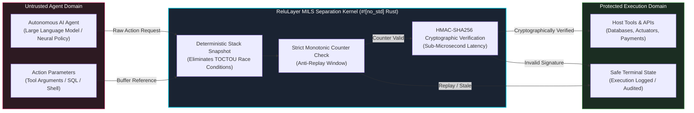

# ReluLayer

**Deterministic, zero-heap MILS separation boundary for autonomous AI agent execution.**

[](https://github.com/ReluLayer/relulayer/actions)
[](LICENSE-APACHE)
[](https://www.rust-lang.org/)
[](https://model-checking.github.io/kani/)

---

## Overview

Autonomous Artificial Intelligence (AI) agents interacting with production tools, databases, and external Application Programming Interfaces (APIs) present critical execution risks, including unauthorized actions, race conditions, and replay attacks. 

Traditional guardrails operate as high-overhead Python runtimes that evaluate text queries, introducing tens of milliseconds of latency without providing memory or execution guarantees.

**ReluLayer** provides a **Multiple Independent Levels of Security (MILS)** separation kernel engineered in `#![no_std]` Rust. Untrusted AI agent reasoning remains strictly isolated on one side of a deterministic execution boundary. A requested action is permitted to cross into execution only after a replay-resistant **Hash-based Message Authentication Code using SHA-256 (HMAC-SHA256)** receipt is validated by an isolated interceptor.

To eliminate Time-of-Check to Time-of-Use (TOCTOU) race conditions, the kernel snapshots the caller buffer into a deterministic memory window before evaluation, ensuring a concurrent thread cannot alter payload parameters mid-flight.

---

## Architectural Separation



### Isolation Guarantees

| Guarantee | Mechanism | Threat Addressed |
|-----------|-----------|------------------|
| **Memory safety** | `#![no_std]` Rust, zero-heap fast path | Use-after-free, heap fragmentation, allocator exploits |
| **Temporal consistency** | Stack snapshot before HMAC verification | TOCTOU race conditions on action payloads |
| **Replay resistance** | Strict monotonic counter + HMAC-SHA256 window | Replay and stale-signature attacks |
| **Boundary integrity** | Foreign Function Interface (FFI) via C Application Binary Interface (C-ABI) | Language-runtime escapes and ABI mismatches |
| **Formal evidence** | Kani model checking on core kernel properties | Undefined behavior and state-space regressions |

---

## Competitive Performance

Guardrails AI and NVIDIA NeMo Guardrails are representative Python-based guardrail runtimes. They parse natural-language prompts and execute validation policies inside a managed interpreter. ReluLayer replaces this interpreter with a deterministic, cryptographically enforced MILS boundary.

### Latency Benchmark

| Runtime | Fast-Path Latency | Relative Slowdown vs. ReluLayer |
|---------|-------------------|--------------------------------|
| **ReluLayer** | **0.199 µs** | **1×** |
| Guardrails AI | 18.2 ms | ~91,457× |
| NVIDIA NeMo Guardrails | 24.5 ms | ~123,115× |

*Measurements reflect single-action validation over a 1 KiB payload on an Intel-class x86-64 host. Python runtimes include import-warmed interpreter overhead. Amazon Web Services (AWS) cloud deployments will observe additional network and virtualization variance.*

### Log-Scale Latency Comparison

```text
Latency (log10 microseconds)
|
| ReluLayer                    █ 0.199 µs  (10^-0.7 µs)
| Guardrails AI                ████████████████████████████████████████ 18.2 ms
| NVIDIA NeMo Guardrails       ██████████████████████████████████████████████████████ 24.5 ms
|
+----|----|----|----|----|----|----|----|----|----|----|----|----|----|----|----|----|---->
     10^-1 µs                  10^1 µs                  10^3 µs                  10^5 µs
```

---

## Getting Started

```bash
# Clone the kernel workspace
git clone https://github.com/ReluLayer/relulayer.git
cd relulayer

# Build the #![no_std] kernel and host bindings
cargo build --release --workspace

# Run the deterministic test suite
cargo test --workspace

# Re-run Kani formal-verification proofs
cargo kani --workspace
```

---

## License

ReluLayer is dual-licensed under the [Apache License, Version 2.0](LICENSE-APACHE) and the [MIT License](LICENSE-MIT). You may use, modify, and distribute this software under either license.
