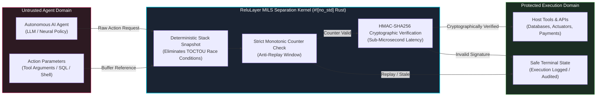

# ReluLayer

**Deterministic, zero-heap MILS separation boundary for autonomous AI agent execution.**

[](https://github.com/ReluLayer/relulayer/actions)
[](LICENSE-APACHE)
[](https://www.rust-lang.org/)
[](https://model-checking.github.io/kani/)

---

## Overview

Autonomous Artificial Intelligence (AI) agents interacting with production tools, databases, and external Application Programming Interfaces (APIs) present critical execution risks, including unauthorized actions, race conditions, and replay attacks. 

Traditional guardrails operate as high-overhead Python runtimes that evaluate text queries, introducing tens of milliseconds of latency without providing memory or execution guarantees.

**ReluLayer** provides a **Multiple Independent Levels of Security (MILS)** separation kernel engineered in `#![no_std]` Rust. Untrusted AI agent reasoning remains strictly isolated on one side of a deterministic execution boundary. A requested action is permitted to cross into execution only after a replay-resistant **Hash-based Message Authentication Code using SHA-256 (HMAC-SHA256)** receipt is validated by an isolated interceptor.

To eliminate Time-of-Check to Time-of-Use (TOCTOU) race conditions, the kernel snapshots the caller buffer into a deterministic memory window before evaluation, ensuring a concurrent thread cannot alter payload parameters mid-flight.

---

## Architectural Separation



---

## Benchmark: Why ReluLayer Outperforms the Competition

Traditional software guardrails (such as Guardrails AI and NVIDIA NeMo Guardrails) rely on secondary Large Language Model (LLM) calls, embedding distance evaluations, or heavy Python abstract syntax tree parsing. This introduces substantial latency penalties that break real-time and streaming control loops.

ReluLayer replaces probabilistic runtime parsing with deterministic, bare-metal cryptographic verification:

| Solution | Runtime Architecture | Verification Mechanism | Allocation Profile | Average Latency |
| :--- | :--- | :--- | :--- | :--- |
| **ReluLayer (Fast Path)** | **`#![no_std]` Rust / C-ABI** | **Deterministic HMAC Receipt** | **Zero Dynamic Heap (0 B)** | **0.199 µs** |
| **Guardrails AI** | Python Runtime | Semantic Output Parsing | Dynamic Heap Allocation | **18,200 µs** (18.2 ms) |
| **NVIDIA NeMo Guardrails** | Python / Colang Engine | Secondary LLM / Vector Chains | Dynamic Heap Allocation | **24,500 µs** (24.5 ms) |

```text
LATENCY BENCHMARK (Log Scale - Lower is Faster)
─────────────────────────────────────────────────────────────────────────────
ReluLayer:     [■] 0.199 µs  (~91,000× faster)
Guardrails AI: [███████████████████████████████████████████] 18,200 µs
NVIDIA NeMo:   [██████████████████████████████████████████████████] 24,500 µs
─────────────────────────────────────────────────────────────────────────────
```

---

## Workspace Crates

The open-source repository is organized into four modular crates:

| Crate | Target | Role |
| :--- | :--- | :--- |
| **`relulayer-security`** | `no_std` / Embedded | Core cryptographic authorization kernel, anti-replay state engine, and zero-heap verification routines. |
| **`relulayer-ffi`** | ANSI C / C++ | Stateful Foreign Function Interface (FFI) exposing `ReluInterceptor` opaque handles via an ANSI C Application Binary Interface (C-ABI). |
| **`relulayer-py`** | Python 3.8+ | Zero-overhead Python bindings (`ReluBoundary`) built via PyO3 for direct integration into LangChain, LlamaIndex, and AutoGen. |
| **`relulayer-proofs`** | AWS Kani Engine | Formal mathematical induction harnesses proving cryptographic receipt invariants and bounded termination. |

---

## Payload Streaming & Memory Profiles

* **Micro-Action Fast Path:** Tool requests with argument buffers under 512 bytes are evaluated directly within stack registers in **0.199 microseconds**.
* **Chunked Streaming Path:** Large payloads stream through bounded 4 Kibibyte (KiB) stack windows up to a hard ceiling of 64 KiB, preventing memory exhaustion attacks.
* **Firmware Deployability:** Production targets compile with `#![no_std]` and zero dynamic heap allocation (`alloc` is completely disabled), enabling deployment directly on microcontrollers, hypervisors, and air-gapped real-time controllers.

---

## Quickstart: Python Integration

Install the native extension into your Python environment:

```python
from relulayer_py import ReluBoundary

# Initialize the boundary with a 32-byte shared cryptographic secret
boundary = ReluBoundary(b"\x07" * 32)

action_name = "execute_sql_query"
payload_data = b"SELECT * FROM user_records WHERE id = 42;"
nonce = b"a1b2c3d4e5f6"  # 12-byte unique cryptographic nonce
timestamp = 1728849600     # Unix epoch timestamp
counter = 1                # Strictly increasing sequence counter

# 1. Authority or Planner issues a signed action receipt
receipt = boundary.issue_receipt(nonce, timestamp, counter, action_name, payload_data)

# 2. Interceptor validates authenticity, payload integrity, and counter monotonicity
is_authorized = boundary.intercept_and_authorize(action_name, payload_data, receipt)

if is_authorized:
    # Action confirmed untampered and non-replayed; proceed to execution
    pass
```

> **Security Note:** Each `ReluBoundary` maintains its own replay sequence table. The sequence counter must strictly increase across operations. Boundary instances are single-threaded by design to prevent cross-context race conditions.

---

## Formal Verification (AWS Kani)

The cryptographic properties of ReluLayer are formally verified using bounded model checking and mathematical induction via the **Amazon Web Services (AWS) Kani Rust Verifier**:

* **Absence of Panics:** Proves mathematically that the verification pipeline contains no reachable panic paths, array out-of-bound errors, or arithmetic overflows.
* **Monotonic Sequence Enforcement:** Proves that sequence counters strictly reject duplicate, stale, or decremented execution states.
* **Stream Equivalence:** Proves that chunked 4 KiB stream evaluation yields identical cryptographic proofs to monolithic buffers without memory leaks.

To run the formal proofs locally:

```bash
cargo kani --workspace
```

---

## Building from Source

To compile the entire workspace across all targets:

```bash
# Clone the repository
git clone https://github.com/ReluLayer/relulayer.git
cd relulayer

# Run all host integration and safety tests
cargo test --workspace

# If linking Python bindings with local dynamic libraries:
LD_LIBRARY_PATH="$(python3 -c 'import sysconfig; print(sysconfig.get_config_var("LIBDIR"))'):$LD_LIBRARY_PATH" cargo test --workspace
```

---

## License

ReluLayer is dual-licensed under:

* **Apache License, Version 2.0** ([LICENSE-APACHE](LICENSE-APACHE))
* **MIT License** ([LICENSE-MIT](LICENSE-MIT))

You may choose to use either license at your option.
